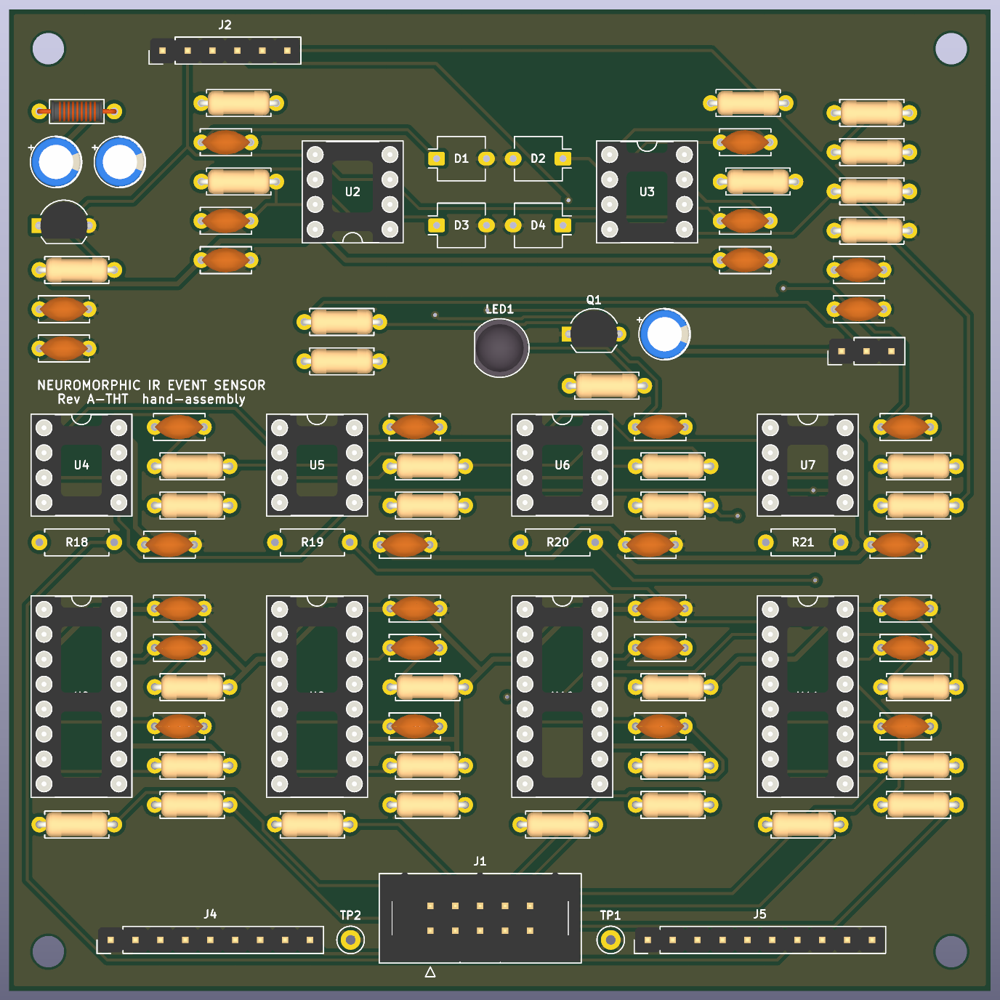

# Neuromorphic IR Event Sensor — Rev A-THT (hand-assembly)

All through-hole re-implementation of the Rev A neuromorphic IR event sensor: no SMD parts, solderable with a basic iron. Same architecture as the SMD design spec: 4 photodiodes → TIA → temporal adaptation → ON/OFF comparators → one-shots → 8 asynchronous 3.3 V spike outputs for the Tang Nano 20K.



- **Board:** 100 × 100 mm, 2 layers, 1.6 mm FR4, 0.3 mm min track, GND pour on both layers
- **Status:** ERC 0 · DRC 0 · schematic↔PCB parity 0 · 0 unconnected
- **Fab files:** `production/neuromorphic-ir-sensor-tht-revA-THT-gerbers.zip` (upload as-is to JLCPCB/PCBWay, bare board only)
- **BOM:** `production/neuromorphic-ir-sensor-tht-BOM.csv` · **Schematic:** `docs/schematic.pdf` · **Assembly drawing:** `docs/assembly_top.pdf`

## Changes from the SMD spec

| Function | SMD Rev A | Rev A-THT | Effect |
|---|---|---|---|
| TIA ×4 | OPA381 | 2× **MCP6022-I/P** (dual, DIP-8) | RF/CF unchanged (18k / 47 pF); ~188 kHz BW, large phase margin |
| Comparators ×8 | 4× TLV3202 | 4× **MCP6542-I/P** (dual, DIP-8) | ~4 µs response, irrelevant vs 2.2 ms adaptation |
| One-shots ×8 | 8× 74LVC1G123 | 4× **74HC123** (dual, DIP-16) | 18k / 12 nF ≈ 100 µs (K≈0.45) — tune on bench |
| VREF | REF3312 1.250 V | **LM385BZ-1.2** 1.235 V + 4.7k | Thresholds ≈ +40.6 / −39.7 mV |
| LED switch | AO3400A | **PN2222A** + 1k base | ~22 mA LED current with 82 Ω |
| Photodiodes | VBPW34FASR | **OSRAM BPW 34 F** (daylight filter) | Same die, THT |

The FPGA connector follows the spec (keyed 2×5: GND, 3V3, SPIKE_ON/OFF × 4). The AER / 2×10 pinout in the old README had no driving circuitry and was dropped.

## Connectors

| Ref | Pins |
|---|---|
| J1 FPGA (2×5 box) | 1 GND · 2 3V3 · 3 ON_TL · 4 OFF_TL · 5 ON_TR · 6 OFF_TR · 7 ON_BL · 8 OFF_BL · 9 ON_BR · 10 OFF_BR |
| J2 DEBUG | 1 GND · 2 VREF · 3–6 VPHOTO_TL/TR/BL/BR (via 100 Ω) |
| J3 LED_EN | 1 3V3 · 2 LED_EN · 3 GND — jumper 1-2 = LED on, 2-3 = off, or drive pin 2 from FPGA |
| J4 RAW_PROBE | 1 GND · 2–9 RAW_ON/OFF_TL, TR, BL, BR |
| J5 EVENT_PROBE | 1 GND · 2 3V3 · 3 3V3A · 4 VREF · 5 VTH_ON · 6 VTH_OFF · 7–10 VEVENT_TL/TR/BL/BR |

## Assembly notes

- Buy 6× DIP-8 and 4× DIP-16 sockets; fit ICs last.
- Solder lowest parts first: resistors → ceramic caps → sockets → TO-92 → electrolytics → headers → photodiodes/LED.
- **Polarity:** photodiode cathode (marked side) → square pad; LED1 cathode (flat) → square pad; electrolytic + marked on silk; U1/Q1 flat side per silk.
- R18–R21 (1 MΩ hysteresis) are **DNP** — fit only if comparators chatter.
- Tuning parts (adaptation R/C, one-shot R/C, thresholds, RLED) can be fitted in machined-pin socket strips for tool-free swapping.
- Keep the photodiode cluster area clear for the M12 lens housing.

## Regenerating (headless)

Everything is generated from `.companion/scripts/design.py` (netlist source of truth). With KiCad closed:

```bash
python .companion/scripts/gen_schematic.py --force
"C:/Program Files/KiCad/10.0/bin/python.exe" .companion/scripts/gen_pcb.py --force
python .companion/scripts/setup_rules.py
# autoroute (kicad-companion autoroute_board / Freerouting), then:
"C:/Program Files/KiCad/10.0/bin/python.exe" .companion/scripts/finalize_pcb.py
python .companion/scripts/setup_rules.py
```

Close KiCad before regenerating: it rewrites the `.kicad_pro` from memory on exit and drops the net classes.

## Open items

- Re-run SPICE with Microchip's MCP6022 / MCP6542 vendor models (not yet in the repo).
- Bench-trim the 74HC123 pulse width (K varies with supply voltage).
- The TIA input nets (photodiode + RF + CF) are autorouted at 22–36 mm total length, well above the spec's 2–8 mm photodiode→op-amp target. The op-amps sit back from the cluster to leave room for the lens housing. Worth a manual tidy-up in KiCad if noise turns out to be a problem on the bench.
